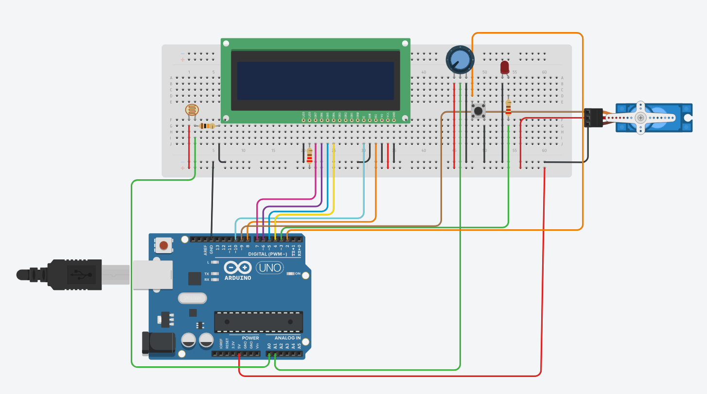
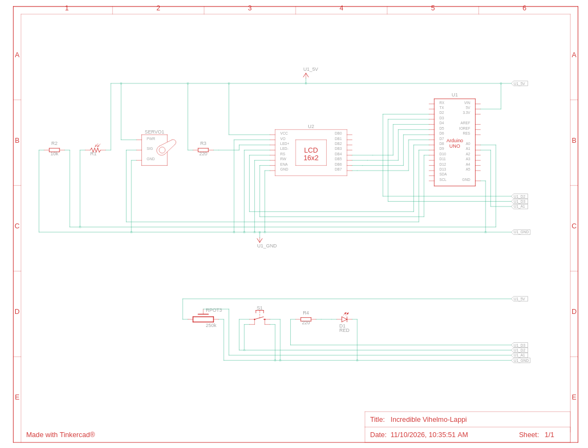

# Smart Blinds — Arduino Uno

**Homework 3 | Robotics**  
**Author:** Deivydas Tamulis

A smart blinds prototype built with an Arduino Uno and simulated in Tinkercad. The system measures ambient light with a photoresistor and adjusts a servo motor to regulate the blinds. A push button switches between automatic and manual operation, while a 16×2 LCD displays the current values.

## Features

- **Automatic mode:** adjusts the servo in 5° steps when the measured light level differs from the target by more than 5 percentage points.
- **Manual mode:** the potentiometer directly controls the servo angle from 0° to 180°.
- **LCD feedback:** displays the measured light level and the active mode's settings.
- **Status LED:** lights up when the servo reaches 180°.
- **Interrupts:** a Timer2 interrupt provides 1 ms timekeeping, and an external interrupt detects button presses.
- **EEPROM:** restores the last saved mode and servo angle after a restart.
- **Non-blocking operation:** periodic tasks are scheduled without `delay()`.

## Circuit

### Components and pin assignments

| Component | Arduino connection | Purpose |
| --- | --- | --- |
| Photoresistor (LDR) with 10 kΩ resistor | A0 | Measures ambient light using a voltage divider |
| Potentiometer | A1 | Sets target light level or manual servo angle |
| Servo motor | D9 (signal) | Moves the blinds |
| 16×2 LCD | RS D8, E D10, D4–D7 (data) | Displays system information |
| Push button | D2 to GND | Switches operating modes |
| Red LED with 220 Ω resistor | D3 | Indicates an angle of 180° |
| Power and ground | 5 V, GND | Supplies the components with a common ground |

The button uses Arduino's internal pull-up resistor (`INPUT_PULLUP`). The LCD also needs the usual power, ground and contrast connections; its backlight is connected through a current-limiting resistor in the prototype.

## How it works

### Automatic mode (`AUTO`)

The potentiometer sets the target brightness (0–100%). Every 200 ms, the Arduino reads the photoresistor and compares the measured brightness with that target:

- Measured light **above target + 5**: increase the servo angle by 5° (up to 180°).
- Measured light **below target − 5**: decrease the servo angle by 5° (down to 0°).
- Difference within ±5 percentage points: leave the servo angle unchanged.

The tolerance prevents continuous adjustment for small changes in light intensity.

### Manual mode (`MANUAL`)

Press the button to switch modes. In manual mode, turning the potentiometer sets the servo angle directly between 0° and 180°. Press the button again to return to automatic mode. Button presses are debounced in software (200 ms).

### Display and storage

The LCD refreshes every 500 ms. The first row shows the measured light percentage; the second shows either `MAN` and the angle or `SET`, the target percentage and the angle.

The program saves the mode and servo angle to EEPROM **3 seconds after the last relevant change**. On startup, valid saved settings are restored. Otherwise, the defaults are automatic mode and 90°.

## Running the project

1. Open **Tinkercad Circuits** and create an Arduino Uno circuit using the wiring shown above.
2. Open the **Code** editor in text mode and paste the contents of [`3darbas.ino`](3darbas.ino).
3. Start the simulation.
4. Change the photoresistor illumination and rotate the potentiometer to test automatic control.
5. Press the button to switch to manual mode, then rotate the potentiometer to position the servo.
6. Optionally open the Serial Monitor at **9600 baud** to see light, target, angle and mode messages.

For a physical Arduino Uno, upload the sketch through the Arduino IDE. It uses the built-in `Servo`, `LiquidCrystal`, and `EEPROM` libraries, plus AVR interrupt support.

## Technical details

| Setting | Value |
| --- | --- |
| Timer2 mode | CTC, prescaler 64, `OCR2A = 249` |
| Timer interrupt period | 1 ms (at 16 MHz) |
| Sensor and servo update | Every 200 ms |
| LCD refresh | Every 500 ms |
| Button debounce | 200 ms |
| EEPROM save delay | 3,000 ms |
| Servo range | 0–180° |
| Serial baud rate | 9600 |

## Limitations

- Brightness is derived from an analog reading and displayed as a percentage, **not** calibrated in lux.
- The simulation uses a servo to represent blinds; a real installation requires a suitable mechanical linkage and power arrangement.
- Stored settings may not persist if power is disconnected before the pending EEPROM write completes.
- Physical servo direction and the meaning of 0°/180° depend on how the blinds are assembled.

## Project files

- [`3darbas.ino`](3darbas.ino) — Arduino source code.
- [`Robotika_3.tex`](Robotika_3.tex) — LaTeX report source.
- [`Robotika_3.pdf`](Robotika_3.pdf) — compiled report.
- [`images/smart_blinds_prototype.png`](images/smart_blinds_prototype.png) — Tinkercad breadboard view.
- [`images/smart_blinds_schematic.png`](images/smart_blinds_schematic.png) — Tinkercad electrical schematic.
